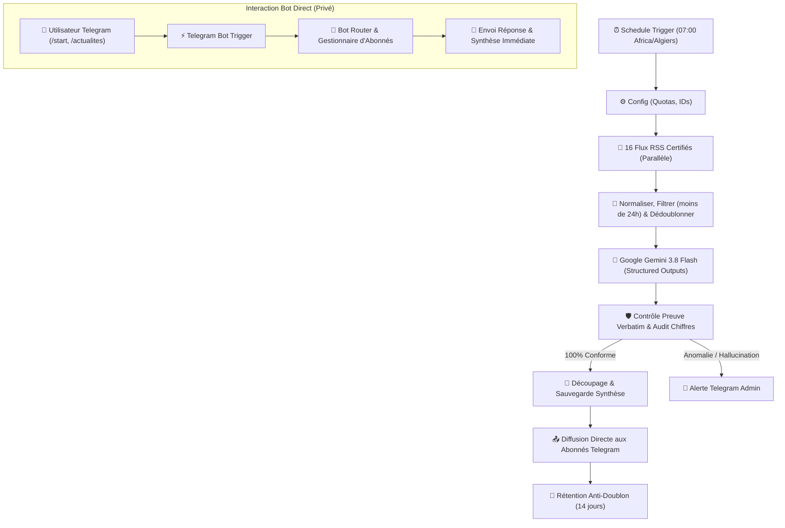

# ⚡ daily-news-n8n-bot

[](https://opensource.org/licenses/MIT)
[](https://n8n.io)
[](https://aistudio.google.com/)
[](https://core.telegram.org/bots)

> **Agent autonome de veille éditoriale & synthèse d'actualités mondiales (IA, Économie, Tech) orchestré sur n8n, motorisé par Gemini 3.8 Flash et garanti 100% sans hallucination.**

---

## 🎯 Ce que fait ce projet

Chaque matin (ou à la demande), le bot :
1. **Scanne 16 flux RSS majeurs** (OpenAI, Google Research, BCE, Fed, Le Monde, TechCrunch, The Verge...).
2. **Filtre, dédoublonne et classe** les articles de moins de 24h (algorithme de similarité de titres Jaccard ≥ 60%).
3. **Génère un briefing structuré** avec **Google Gemini 3.8 Flash** via JSON Schema strict.
4. **Applique un contrôle anti-hallucination cryptographique** : chaque fait cité doit contenir une preuve verbatim mot pour mot présente dans la source, et tous les chiffres sont audités.
5. **Diffuse le briefing en message privé** directement à vos abonnés Telegram via commandes interactives (`/start`, `/actualites`, `/filter_ia`, `/stats`, `/stop`).

---

## 🏗️ Architecture du Pipeline



---

## 🚀 Démarrage Rapide en 3 Étapes

### 1. Cloner et configurer l'environnement
```bash
git clone https://github.com/nadhirXt/daily-news-n8n-bot.git
cd daily-news-n8n-bot
cp .env.example .env
```

### 2. Démarrer n8n avec Docker
```bash
docker compose up -d
```
Accédez à n8n sur `http://localhost:5678`.

### 3. Importer le Workflow & Lancer
1. Dans n8n, créez un workflow et importez le fichier [`workflows/news-pipeline.json`](workflows/news-pipeline.json).
2. Renseignez vos 2 credentials dans n8n :
   - **`Gemini API Key`** (Header Auth : `x-goog-api-key` récupéré sur [Google AI Studio](https://aistudio.google.com/)).
   - **`Telegram account`** (Token du bot fourni par [@BotFather](https://t.me/BotFather)).
3. Activez le workflow. Envoyez `/start` à votre bot sur Telegram : vous êtes abonné !

---

## 📡 Les 16 Flux RSS Intégrés

| # | Catégorie | Source | Nature / Fiabilité | Statut |
|---|---|---|---|---|
| 1 | **IA** | Google Research | Tier 1 (Lab Officiel) | ✅ Validé |
| 2 | **IA** | OpenAI Blog | Tier 1 (Lab Officiel) | ✅ Validé |
| 3 | **IA** | NVIDIA News | Tier 1 (Entreprise) | ✅ Validé |
| 4 | **IA** | Hugging Face | Tier 1 (Entreprise) | ✅ Validé |
| 5 | **IA** | MIT Tech Review AI | Tier 3 (Presse Spécialisée) | ✅ Validé |
| 6 | **IA** | TechCrunch AI | Tier 3 (Presse Spécialisée) | ✅ Validé |
| 7 | **Économie** | BCE / ECB Press | Tier 1 (Institution Officielle) | ✅ Validé |
| 8 | **Économie** | Federal Reserve Press | Tier 1 (Institution Officielle) | ✅ Validé |
| 9 | **Économie** | BBC Business | Tier 2 (Média Référence) | ✅ Validé |
| 10 | **Économie** | France 24 Éco-Tech | Tier 2 (Média Référence) | ✅ Validé |
| 11 | **Économie** | DW Business | Tier 2 (Média Référence) | ✅ Validé |
| 12 | **Économie** | Le Monde Économie | Tier 2 (Média Référence) | ✅ Validé |
| 13 | **Économie** | The Guardian Business | Tier 2 (Média Référence) | ✅ Validé |
| 14 | **Économie** | MarketWatch | Tier 2 (Média Spécialisé) | ✅ Validé |
| 15 | **Tech** | Ars Technica | Tier 3 (Presse Spécialisée) | ✅ Validé |
| 16 | **Tech** | The Verge | Tier 3 (Presse Spécialisée) | ✅ Validé |

---

## 🛡️ Pourquoi ce bot ne peut PAS halluciner

Les synthèses d'actualités par IA classique souffrent souvent de confusions de dates, de chiffres déformés ou de faux liens. Ce bot implémente une **sécurité stricte en code JavaScript** :

- **Pas d'URL générée par l'IA** : Tous les liens sont reconstruits en dur par n8n à partir du flux RSS d'origine.
- **Règle de la Preuve Verbatim** : Chaque actualité produite par Gemini doit fournir un extrait textuel exact (≤ 15 mots) issu du texte brut de la source. Si la phrase n'existe pas dans le texte original, l'article est rejeté.
- **Audit strict des nombres** : Tout chiffre ou pourcentage présent dans le résumé doit impérativement figurer dans la source d'origine.

---

## 📚 Documentation Développeur

- [Guide d'Initiation & Architecture](docs/DEVELOPMENT_GUIDE.md) : Comment ajouter des flux, changer de modèle IA, exécuter des tests locaux.
- [Guide de Contribution](CONTRIBUTING.md) : Comment soumettre des améliorations.

---

## 📄 Licence

Ce projet est sous licence open-source **MIT** — voir le fichier [LICENSE](LICENSE) pour plus de détails.
