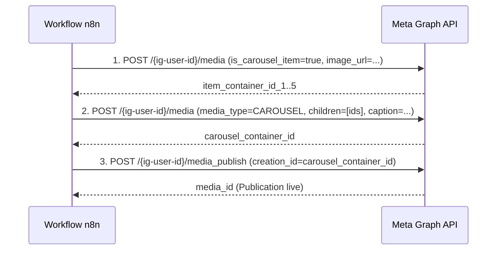

# Guide d'Implémentation Phase 2 — Publication Instagram Carrousel

Ce document détaille les prérequis, l'architecture technique, et les étapes pas à pas pour étendre le pipeline n8n vers la publication automatique d'un carrousel Instagram quotidien.

---

## 1. Prérequis Meta (Facebook Graph API)

L'API Instagram Graph n'autorise la publication automatique que sur des comptes **Professionnels (Business ou Créateur)** reliés à une **Page Facebook**.

### Étape 1.1 : Type de compte Instagram
1. Ouvrir l'application Instagram > **Paramètres et confidentialité** > **Type de compte et outils**.
2. Basculer vers un **Compte professionnel** (choisir la catégorie *Média/Actualités* ou *Créateur*).

### Étape 1.2 : Liaison avec une Page Facebook
1. Créer une Page Facebook (ex. *L'Essentiel du Jour*).
2. Dans les paramètres de la Page Facebook > **Comptes associés** > **Instagram** > **Associer le compte**.
3. Confirmer l'accès complet.

### Étape 1.3 : Création de l'application Meta Developer
1. Se rendre sur [developers.facebook.com](https://developers.facebook.com/) et créer un compte développeur.
2. Cliquer sur **Créer une application** > Sélectionner le cas d'usage **Autre** > Type d'application : **Entreprise** (*Business*).
3. Nommer l'application (ex. `Daily News Automation`).

### Étape 1.4 : Permissions requises
Dans le tableau de bord de l'application, ajouter le produit **Instagram Graph API**. Les permissions suivantes sont obligatoires :
- `instagram_basic` : lecture de l'identifiant du compte et métadonnées.
- `instagram_content_publish` : création de conteneurs médias et publication de carrousels.
- `pages_show_list` : détection des pages Facebook gérées par l'utilisateur.
- `pages_read_engagement` : interaction avec la page liée.

---

## 2. Génération du Token Longue Durée (60 jours)

Les tokens générés via le Graph API Explorer expirent au bout d'une heure. Il faut les convertir en token d'accès page pérenne :

1. **Obtenir un User Token court** depuis le **Graph API Explorer** avec les 4 permissions ci-dessus.
2. **Échanger contre un User Token longue durée** (valable 60 jours) :
   ```bash
   curl -X GET "https://graph.facebook.com/v21.0/oauth/access_token\
     ?grant_type=fb_exchange_token\
     &client_id={VOTRE_APP_ID}\
     &client_secret={VOTRE_APP_SECRET}\
     &fb_exchange_token={TOKEN_COURT}"
   ```
3. **Obtenir le Token Page Permanent** (ne périme pas sauf révocation) :
   ```bash
   curl -X GET "https://graph.facebook.com/v21.0/me/accounts?access_token={TOKEN_LONGUE_DUREE}"
   ```
   Noter l'`access_token` associé à la Page Facebook liée à votre compte Instagram.
4. **Récupérer l'identifiant Instagram Business (`IG_USER_ID`)** :
   ```bash
   curl -X GET "https://graph.facebook.com/v21.0/{PAGE_ID}?fields=instagram_business_account&access_token={PAGE_ACCESS_TOKEN}"
   ```

---

## 3. Architecture de Rendu d'Images (HTML → PNG)

L'API Instagram exige que les images soient hébergées sur une **URL publique accessible sans authentification** au moment de l'ingestion par les serveurs Meta.

### Extension `docker-compose.yml` (Phase 2)

Ajout d'un service léger de capture d'écran headless (ex. conteneur Puppeteer / Gotenberg / Browserless) :

```yaml
services:
  # Service de rendu HTML vers PNG
  renderer:
    image: browserless/chrome:latest
    restart: unless-stopped
    ports:
      - "3000:3000"
    environment:
      - MAX_CONCURRENT_SESSIONS=2
      - PREBOOT_CHROME=true

  # Serveur de fichiers statiques public (ou bucket MinIO / S3 / Cloudflare R2)
  static-files:
    image: nginx:alpine
    restart: unless-stopped
    ports:
      - "8080:80"
    volumes:
      - ./rendered_slides:/usr/share/nginx/html/slides:ro
```

---

## 4. Workflow de Publication Instagram Graph API

Le carrousel est publié selon un protocole en 3 étapes successives :



### Étape 4.1 : Création de chaque conteneur slide
Pour chacune des 5 images (1 couverture + max 4 synthèses) :
```http
POST https://graph.facebook.com/v21.0/{ig-user-id}/media
Content-Type: application/json

{
  "image_url": "https://votre-domaine.com/slides/slide_1.png",
  "is_carousel_item": true,
  "access_token": "{PAGE_ACCESS_TOKEN}"
}
```
*Réponse :* `{ "id": "17923456789012345" }`

### Étape 4.2 : Création du conteneur parent Carrousel
```http
POST https://graph.facebook.com/v21.0/{ig-user-id}/media
Content-Type: application/json

{
  "media_type": "CAROUSEL",
  "children": [
    "17923456789012345",
    "17923456789012346",
    "17923456789012347",
    "17923456789012348",
    "17923456789012349"
  ],
  "caption": "🗞️ L'essentiel de l'actualité mondiale ce 17 octobre 2026.\n\nFaites glisser pour découvrir les faits marquants en Géopolitique, Économie et Technologies.\n\n🔎 Sources : BBC, Le Monde, Ars Technica, France 24.\n\n#actualite #geopolitique #economie #technologie #information",
  "access_token": "{PAGE_ACCESS_TOKEN}"
}
```
*Réponse :* `{ "id": "18099887766554433" }`

### Étape 4.3 : Publication effective
Attendre 3 à 5 secondes (le temps que Meta télécharge les images depuis l'URL publique), puis déclencher la publication :
```http
POST https://graph.facebook.com/v21.0/{ig-user-id}/media_publish
Content-Type: application/json

{
  "creation_id": "18099887766554433",
  "access_token": "{PAGE_ACCESS_TOKEN}"
}
```
*Réponse :* `{ "id": "17855443322110099" }` (Identifiant du post publié sur Instagram).

---

## 5. Limites et Bonnes Pratiques

| Paramètre | Limite Meta API | Recommandation Projet |
|-----------|-----------------|----------------------|
| **Taille carrousel** | 2 à 10 slides | 5 slides (1 cover + 4 actus phares) |
| **Ratio image** | 4:5 (1080x1350px) | 1080x1350px (strictement respecté dans `card.html`) |
| **Format** | JPEG ou PNG (< 8 Mo) | PNG optimisé (environ 400 Ko) |
| **Quota journalier** | 50 publications / 24h | 1 publication par jour |
| **Longueur légende** | 2 200 caractères max | ~500 caractères avec 5-8 hashtags ciblés |
| **Disponibilité URL** | Accès direct HTTP 200 | Pas de Cloudflare Bot Fight Mode bloquant Meta |
| **Expiration Token** | 60 jours si User Token | Renouveler via un webhook ou cron automatique tous les 45 jours |
